<a href="https://dhanushkumar.co.in">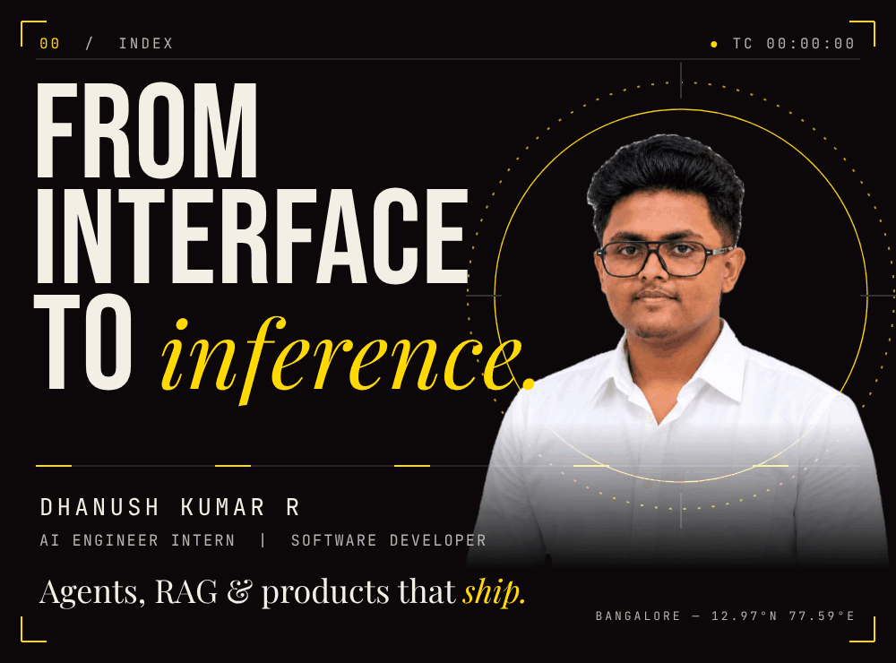</a>

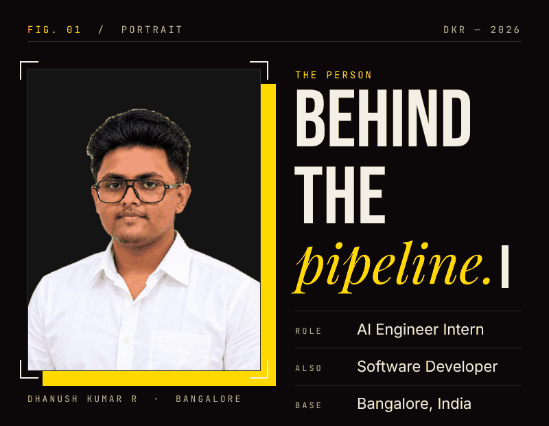
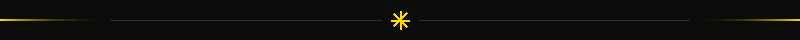
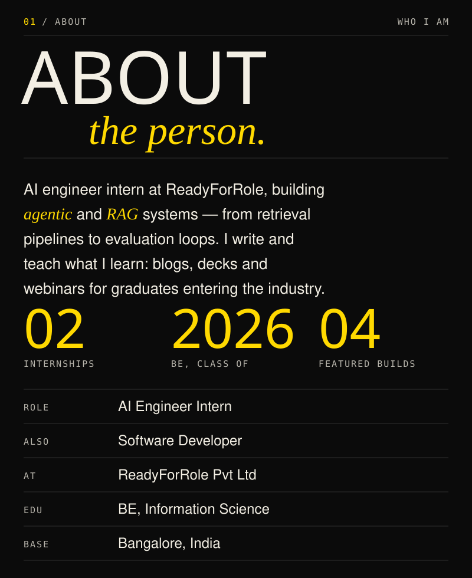

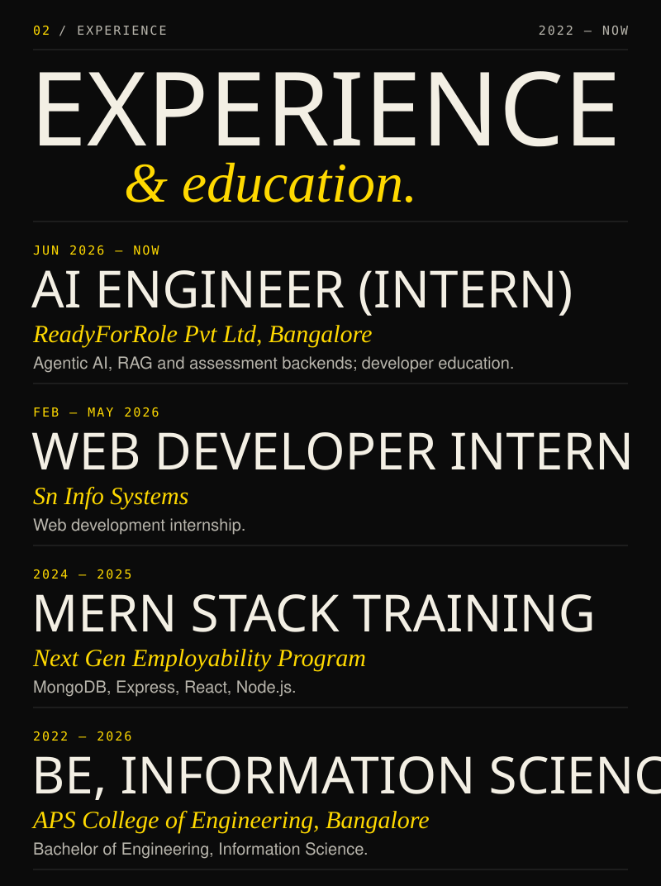

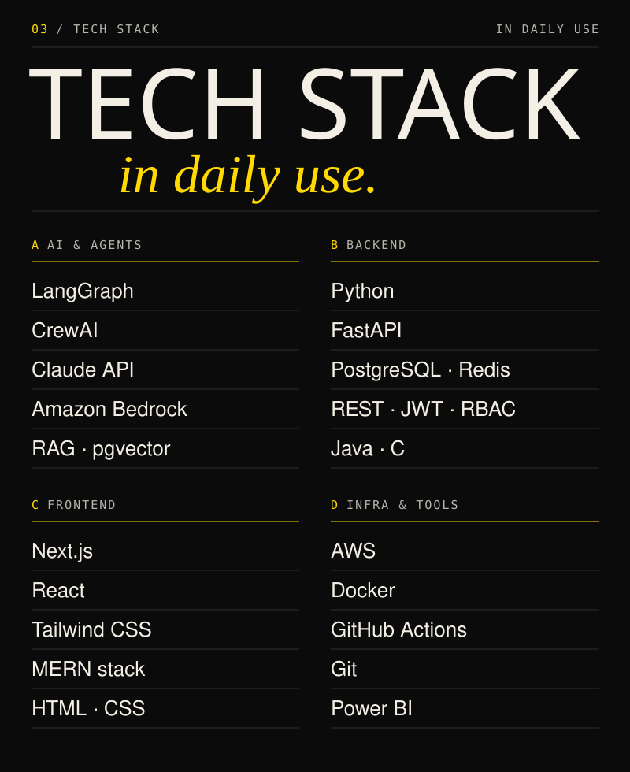

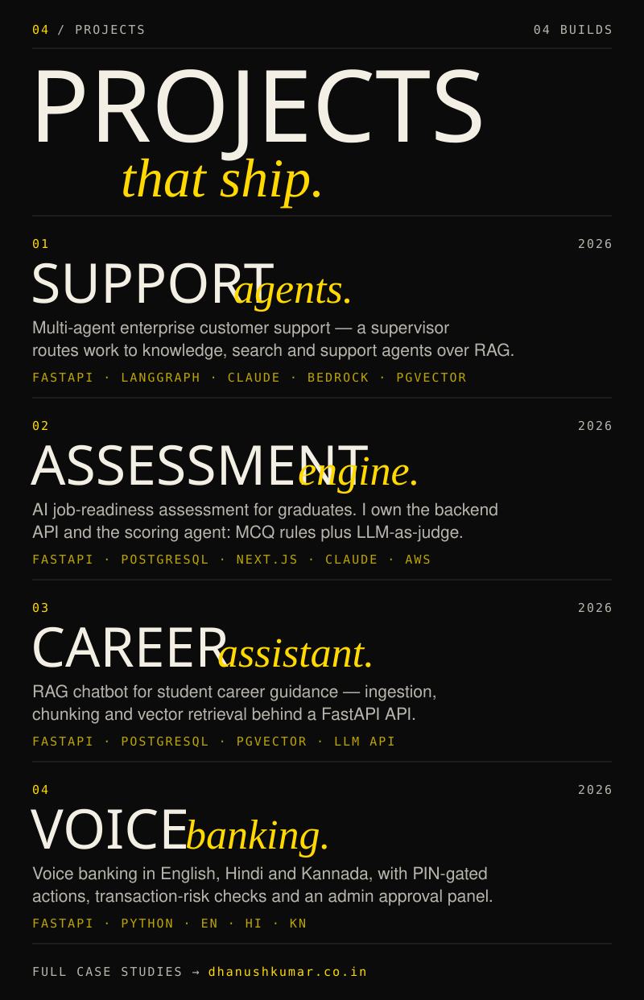

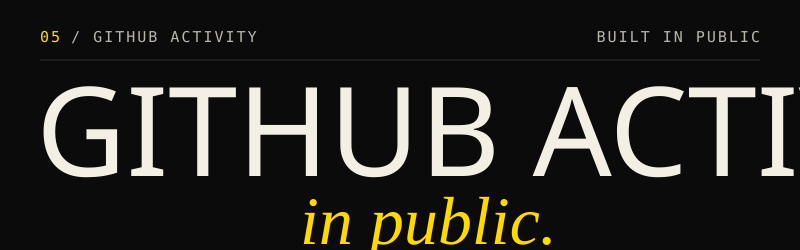
<a href="https://github.com/Dhanux05">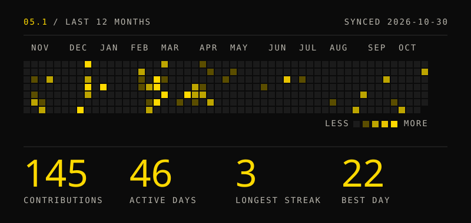</a>

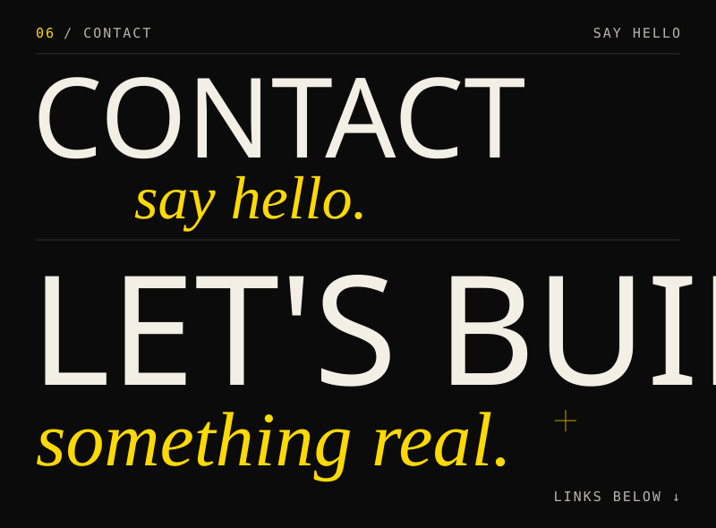
<a href="https://dhanushkumar.co.in">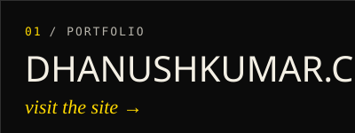</a>
<a href="https://github.com/Dhanux05">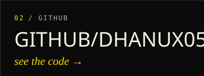</a>
<a href="https://linkedin.com/in/dhanushkumar-co-in">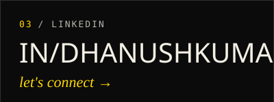</a>
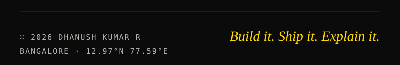
